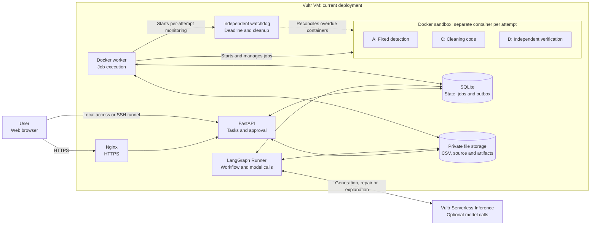
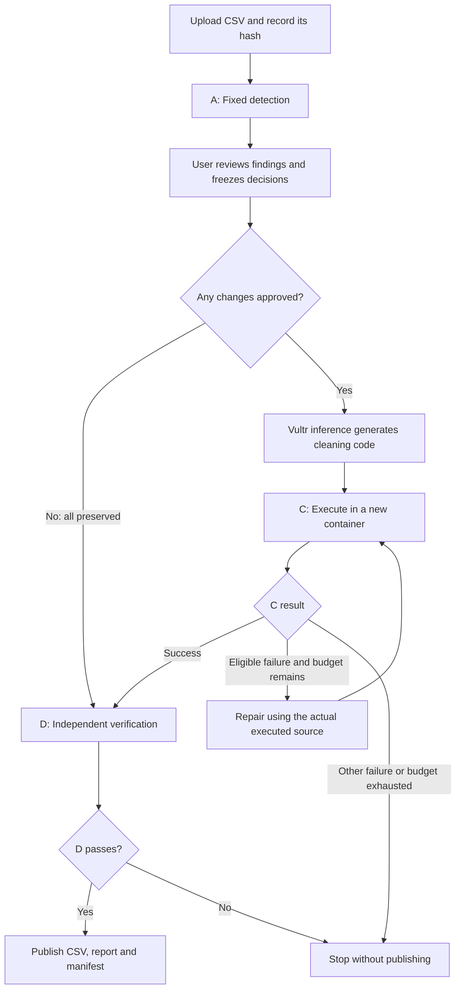

# Architecture

## What The Project Does

AI Data Agent helps a user clean a CSV while retaining control over what changes. Fixed tools first identify supported issues; the user approves the actions; a model generates cleaning code; and an independent verifier checks the result against the approved rules before it can be downloaded.

The model proposes an implementation, not the rules or the final verdict. The business goal is descriptive and does not automatically authorize changes. If every column is preserved, the model and cleaning step are skipped and the original input is independently verified.

In the current deployment, a Vultr VM hosts the application, storage and Docker jobs. Vultr Serverless Inference provides the `deepseek-v4.1-flash-1017` model for approved model-assisted work.

## System Architecture

The API, Runner and worker are separate processes sharing SQLite and file storage on the VM. The API does not execute generated code or manage containers. The Runner calls Vultr Serverless Inference from outside the job containers; the containers themselves have no network access. The project also supports local operation without the VM.

## Modules

| Module | Responsibility |
| --- | --- |
| Vultr VM and Serverless Inference | Host the application and isolated jobs on the VM; provide the model endpoint for generation, eligible repair and optional explanation. |
| Web interface and API | Upload CSVs, display findings, collect approval, show status and provide verified downloads. |
| Workflow Runner | Uses LangGraph to coordinate stages, pause for approval and resume durable work through an outbox. Requests generation or eligible repair. |
| Fixed detection A | Examines CSV structure, empty cells, duplicate rows, supported dates and numeric ranges. Findings do not authorize changes. |
| Docker worker and watchdog | Run each A, C or D attempt in a fresh container, enforce fixed limits and reconcile overdue containers. |
| Model and cleaning C | The model proposes code from an approved summary; C executes the resulting source inside a container. |
| Independent verification D | Compares the original input, candidate output and frozen rules without relying on the generated code's judgment. |
| Storage and publication | Store task state, inputs, source snapshots and artifacts. Check bindings and hashes before publishing and again when downloading. |

## Workflow

The frozen specification is bound to the input hash, task version and owner. Available actions are **Preserve**, filling exactly empty strings with a literal, and normalizing selected valid dates to `YYYY-MM-DD`. Each column has at most one action, and at least one column must remain unchanged to check row correspondence. A blank fill value is permitted but does not change empty cells. Columns without findings remain unchanged.

Duplicate rows and numeric findings do not authorize deletion or numeric cleanup. The fixed detector does not identify malformed email addresses or flag invalid dates as date issues. D checks the approved transformations, row positions and protected cells; it does not decide whether the rules match the user's business intent or prove that no other data issues exist.

## Container Isolation

Each A, C or D attempt runs in its own fresh Docker container, including retries. The worker uses a fixed image and stage policy rather than accepting limits from the model:

- **Image and host:** Execution uses verified local image IDs rather than mutable tags. The worker requires a Linux Docker engine with seccomp and memory, swap and PID limit support.
- **Network and privileges:** Networking is disabled, the process runs as a non-root user, capabilities are dropped, and `no-new-privileges` is enabled.
- **Filesystem:** The root filesystem and job input are read-only. Output and temporary files use size-limited tmpfs with `noexec`, `nosuid` and `nodev`; job containers have no writable host mounts.
- **Resources:** CPU, memory, PID count and wall time are bounded. The worker also limits output collection.
- **Recovery:** A per-attempt watchdog can reconcile an overdue container after a worker failure. If container creation is uncertain, the worker stops accepting new work until the situation is resolved; an empty container list alone is not proof of recovery.

| Stage | Memory | CPU budget | PID limit | Output tmpfs | Wall timeout |
| --- | ---: | ---: | ---: | ---: | ---: |
| A: Detection | 256 MiB | 30 s | 32 | 1,000,000 bytes | 45 s |
| C: Cleaning | 512 MiB | 45 s | 32 | 12,000,000 bytes | 60 s |
| D: Verification | 256 MiB | 30 s | 32 | 1,000,000 bytes | 45 s |

These are configured limits, including a one-CPU quota. Docker containers share the host kernel and do not guarantee protection from kernel compromise. Timely cleanup cannot be guaranteed if the host, Docker, watchdog or filesystem is unavailable. See [security](security.md) and [testing](testing.md) for boundaries and observed checks.

## Security Architecture

The design applies separate controls at the network, application, model, container and publication boundaries. These layers reduce exposure but are not a production security certification.

### Access And Resource Admission

- **Ingress:** In the current online deployment, Nginx terminates HTTPS and forwards requests to an API listening on `127.0.0.1`. The deployed configuration is based on the supplied template, which also limits request rate, connections and request size. These proxy limits apply only when that configuration is installed.
- **Authentication:** Task APIs and `/ready` require the shared demo token; the static page and `/health` are public. The launcher generates a new token on each start. Task API responses use `Cache-Control: no-store`.
- **Capacity:** The API enforces a configurable upload-size limit, an active-task cap and a minimum-free-disk check. Fixed model-call and container limits bound individual work, but there is no account-wide monetary spending cap.
- **Boundary:** This is one shared demo identity, not separate user accounts. Anyone with the token may access shared tasks; HTTPS does not provide multi-user isolation. Use non-sensitive data and share the token privately.

### Approval, Model And Data

- **Human approval:** Detection findings and the business goal do not authorize changes. The server validates and freezes the decisions, binding them to the task, input hash and task version. External inference must be explicitly enabled; the web approval form also asks the user to confirm the data-sharing notice. That checkbox is a UI confirmation, not an independently enforced per-user consent record for direct API access.
- **Data minimization:** Initial generation sends anonymized column indices, approved-rule summaries and aggregate statistics. Raw CSV rows, real column names, fill values, and raw exception messages or stacks are not intentionally sent as separate data. The repair request includes the complete source actually executed by the failed attempt and limited diagnostics; that source may itself contain sensitive information.
- **Model transport and secrets:** The Runner calls Vultr Serverless Inference over HTTPS. The default client does not inherit arbitrary proxy settings; a local proxy must be explicitly enabled. The launcher removes inference keys from the API and worker environments, and job containers receive only the stage setting in their configured environment. Credentials and runtime files must remain private and outside Git.
- **Bounded model calls:** Generation and repair share at most three code-generation calls per task, with at most three C attempts. A call ledger records attempts; uncertain or failed external calls are not silently repeated. The optional D explanation is a separate, potentially billable call: it uses allowlisted D facts and cannot change the verdict, publication or download access.

### Untrusted Code And Container Output

- **Source gate:** Model responses must match the expected format and frozen specification. Static source checks reject selected disallowed imports and operations before execution; they are a protocol check, not the sandbox.
- **Runtime guard:** Generated C code runs only in the restricted job container. A Python audit hook rejects and classifies selected risky operations as an additional check; it does not replace Docker isolation.
- **Snapshots and collection:** Before execution, the worker prepares a read-only input snapshot and checks its input, specification and, where applicable, candidate hashes. After execution, a trusted collector stops remaining container processes and collects only allowed, size-bounded regular files. The worker validates the returned archive rather than extracting arbitrary paths or links on the host.
- **Source and repair:** The original model response and the actual executed source are separately recorded and hashed. For eligible implementation failures, repair receives the hash-verified source from the failed attempt. Security and resource failures and D rejection cannot be bypassed by repair.

### Verification, Publication And Recovery

- **Independent verification:** D reads the original input, frozen rules and candidate output in a separate container, checking approved cell changes, protected cells and row positions. In an all-preserve task, complete input and output bytes must also match; when changes are approved, byte equality is not required.
- **Publication and downloads:** The publisher checks D's report and its bindings to the input, specification and candidate before registering artifacts. Artifact access checks the task state, private paths, file type, size and hash; downloads verify the registered bytes again. The evidence API exposes selected metadata rather than raw source, logs or host paths.
- **Recovery:** The watchdog operates independently of the worker and uses the attempt identity and deadline for cleanup. An uncertain Docker create or cleanup blocks further worker consumption until reconciliation. Timely recovery still depends on the host, Docker, watchdog and filesystem being available.
- **Residual exposure:** Runtime data, limited logs, model responses and the user interface may contain sensitive information. CSV exports may contain spreadsheet formulas. Container isolation shares the host kernel; operators must protect the VM, stored files, credentials and any authorized proxy.

Selected VM isolation, resource and recovery checks passed, and two unauthenticated task requests were rejected over HTTPS. These observations are scoped to the tested cases; see [testing](testing.md).

## CSV Contract

CSV input is UTF-8 with optional BOM, comma-separated, with consistent column counts and nonempty unique headers. The parser permits up to 10 MiB, 100,000 rows, 100 columns, 32,768 characters per field and 1,000,000 cells; the API has a separate configurable upload limit.

Missing means exactly an empty string, not whitespace or `NA`. Supported date inputs are `YYYY-MM-DD`, `YYYY/MM/DD` and `DD-MM-YYYY`. Only explicitly selected valid dates are converted; unparseable values are preserved. Rows are not deleted, deduplicated or reordered.

## Future Extensions

The current design favors a controlled single-host workflow. It can be extended in several directions while retaining human approval and independent verification:

- **Conversational analysis and cleaning:** Clarify the user's requirements through dialogue, generate file-analysis code, then obtain approval for the proposed cleaning rules and generate cleaning code. Both stages could run in isolated containers with bounded repair based on the failed attempt's actual executed source. This extension would also need privacy safeguards and verification suited to the newly approved rules.
- **Rules:** New cleaning actions require coordinated changes to fixed detection, approval, code generation and D; the rule set and support for multiple actions per column can grow together.
- **Deployment:** SQLite and local files serve the current single-host setup. Shared storage and distributed coordination could support broader deployments.
- **Model integration:** The Vultr inference integration can be expanded with additional compatibility checks and explicit recovery policies.
- **Access and operations:** Separate user identities, isolated task ownership, spending controls and improved monitoring could support wider use.
